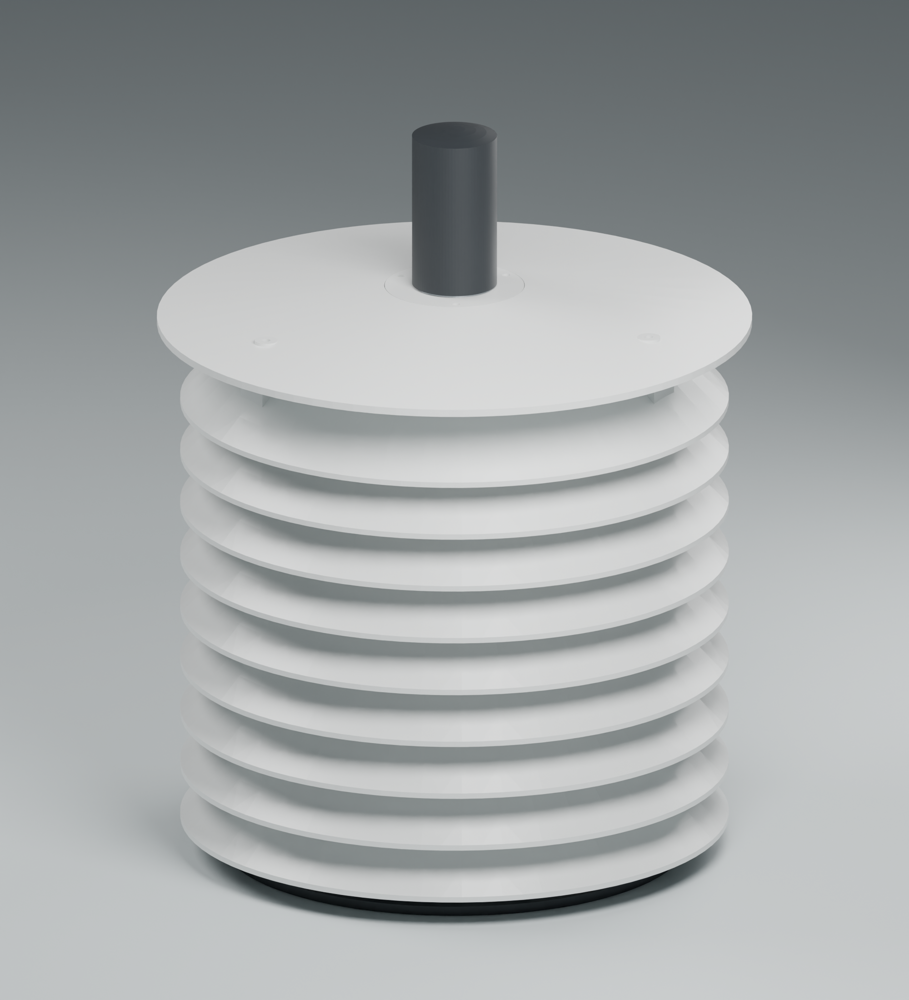
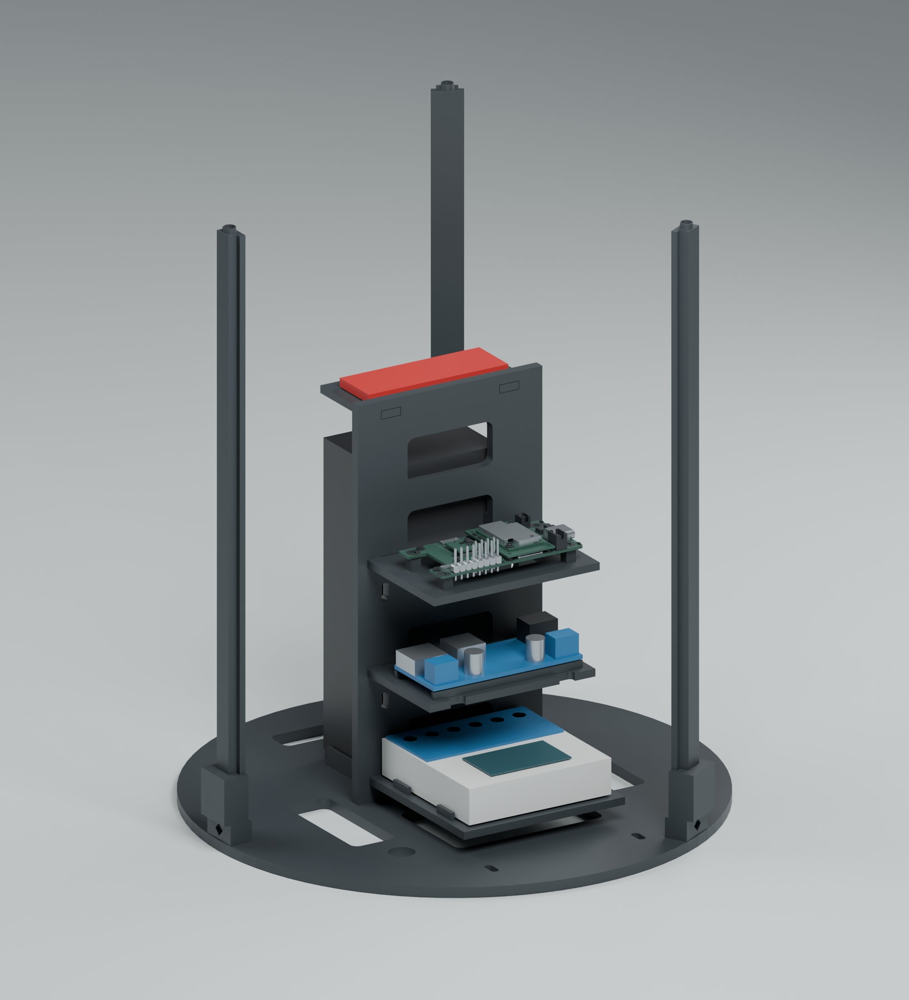

# Renders Gill V7

Dos renders con materiales, iluminación de estudio, sombras y cámara ortográfica, generados desde la geometría STEP del proyecto. Son representaciones digitales; las [fotografías](../../hardware/fotos/README.md) documentan el montaje físico.

## Diseño exterior completo · no fabricado

Tapa, nueve aletas y disco de antena se conservan como diseño exterior. El acabado claro representa el material exterior previsto, no una impresión realizada. No se fabricaron por indisponibilidad de ASA; se descartó imprimir la envolvente en PLA para exposición solar. Antena y electrónica son referencias de montaje; esta imagen no prueba estanqueidad ni resistencia.

## Interior sin tapa ni aletas

Base, tres guías, placa y cuatro bandejas reproducen los STEP del interior fabricado, con acabado PLA oscuro. Consumo conjunto comunicado: unos 160 g. Se ocultan tapa, aletas, disco y antena sobre la tapa para mostrar el alcance físico sin envolvente. Batería de 120 × 50 × 40 mm; electrónica comercial de referencia, sin sustituir la fotografía ni afirmar correspondencia de todos los detalles o del cableado real. El BMS se representa como volumen protegido: su modelo no está identificado.

## Reproducción y trazabilidad

[Instrucciones y scripts](../../tools/renders/README.md), [fuentes y SHA-256](gill-v7-75mm/fuentes-render.json) y [mallas reproducibles](gill-v7-75mm/mallas.json.gz). Los renders conservan dimensiones y posiciones del ensamble; se excluyen cables, bridas, insertos y tornillos de presentación para no confundir sus volúmenes representativos con un pinout o un montaje real comprobado. Las cotas se consultan en los [planos](../planos/README.md).

## Vistas anteriores de inspección

- [Conjunto en visor CAD](gill-v7-75mm/gill_v7_completo.png).
- [Interior con aletas ocultas](gill-v7-75mm/gill_v7_interior_guardado.png), conserva tapa y antena del diseño.
- [Detalle de tapa y antena](gill-v7-75mm/tapa_v7_montada.png).

Estas capturas conservan la revisión digital anterior; no son evidencia de fabricación exterior.
