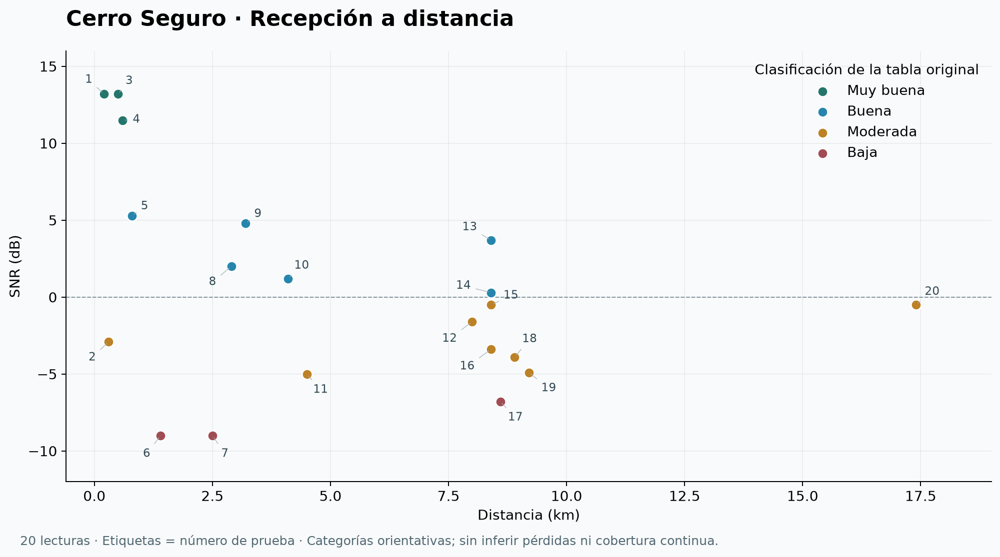

# Pruebas de comunicación a distancia

Registro incorporado el **16 de noviembre de 2026**. La fecha de incorporación no se asigna como fecha del ensayo. La tabla aportada por el equipo es la evidencia original: [imagen](evidencias/pruebas-distancia-snr.png), [CSV transcrito](datos/distancia-snr.csv).

## Resultados

| Prueba | Distancia (km) | SNR (dB) | Calidad orientativa |
|---:|---:|---:|---|
| 1 | 0,2 | 13,2 | Muy buena |
| 2 | 0,3 | -2,9 | Moderada |
| 3 | 0,5 | 13,2 | Muy buena |
| 4 | 0,6 | 11,5 | Muy buena |
| 5 | 0,8 | 5,3 | Buena |
| 6 | 1,4 | -9,0 | Baja |
| 7 | 2,5 | -9,0 | Baja |
| 8 | 2,9 | 2,0 | Buena |
| 9 | 3,2 | 4,8 | Buena |
| 10 | 4,1 | 1,2 | Buena |
| 11 | 4,5 | -5,0 | Moderada |
| 12 | 8,0 | -1,6 | Moderada |
| 13 | 8,4 | 3,7 | Buena |
| 14 | 8,4 | 0,3 | Buena |
| 15 | 8,4 | -0,5 | Moderada |
| 16 | 8,4 | -3,4 | Moderada |
| 17 | 8,6 | -6,8 | Baja |
| 18 | 8,9 | -3,9 | Moderada |
| 19 | 9,2 | -4,9 | Moderada |
| 20 | 17,4 | -0,5 | Moderada |

Se registran **20 lecturas**, entre **0,2 y 17,4 km**, con SNR entre **−9,0 y 13,2 dB**. En el punto más distante, la lectura fue **−0,5 dB a 17,4 km**. Las cuatro observaciones a 8,4 km abarcan de −3,4 a 3,7 dB: la distancia por sí sola no explica la variación. Las categorías transcritas son orientativas: 3 «Muy buena», 6 «Buena», 8 «Moderada» y 3 «Baja».

## Interpretación y límites

La serie documenta recepción en los puntos registrados, incluido el de 17,4 km. No representa cobertura garantizada, precisión de ubicación ni alcance de un enlace directo: no consta si hubo saltos intermedios. Un SNR negativo indica señal por debajo del nivel de ruido estimado; en estas observaciones se recibió el paquete. No se deduce una tasa de pérdidas a partir de SNR.

El resultado previo de **20/20 mensajes recibidos, sin pérdidas y todos bajo 60 s** se conserva en el [cierre funcional](cierre-funcional-avance3.md). La imagen no asocia cada lectura con un mensaje de esa campaña ni aporta tiempos por fila; no se asignan entregas, ACK o latencias individuales a estas distancias.

La tabla original no contiene fecha/hora, trazado, obstáculos, alturas, RSSI, potencia, SF/BW ni número de saltos. La configuración documentada del sistema sigue disponible en el [ensayo de banco](banco-rak-heltec.md), pero no se atribuye retrospectivamente a esta serie sin un registro que la vincule.

## Tratamiento de datos

Transcripción literal de las veinte filas, sin suavizado ni exclusiones. En CSV se utiliza punto decimal y unidades explícitas en los encabezados. Las cuatro distancias iguales se conservan; la gráfica desplaza sus etiquetas, no las coordenadas. La gráfica se reproduce con `python tools/renders/graficar_distancia.py` y no une puntos para sugerir continuidad de cobertura.
